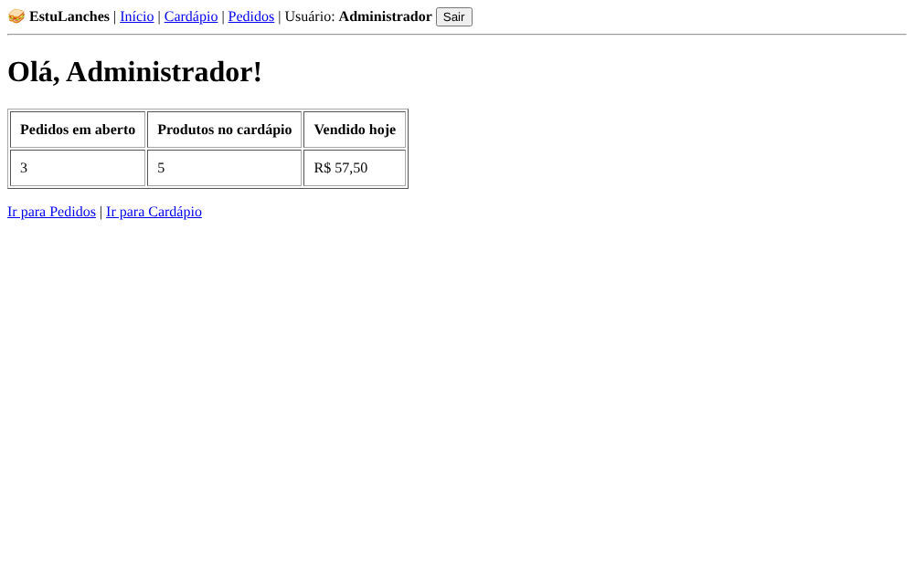
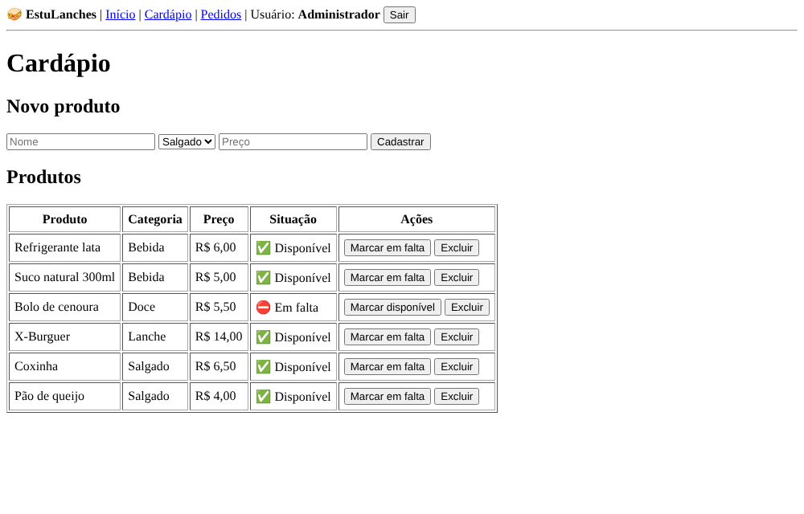
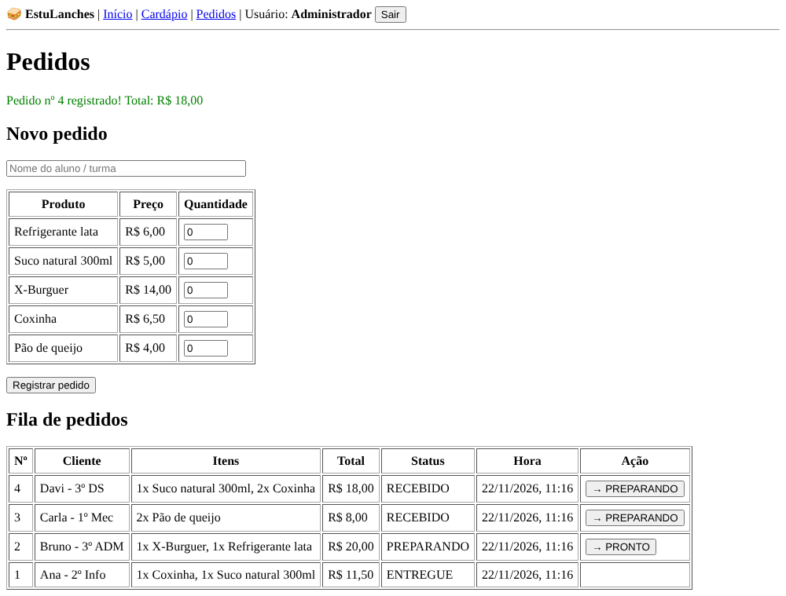

# 🥪 EstuLanches — Implantação com Docker

Sistema web para a **cantina escolar**: gestão de **cardápio** e **pedidos**, implantado em produção com **Docker** e **Docker Compose**.

**Problema:** os pedidos da cantina eram anotados em papel. A fila virava bagunça, produtos em falta continuavam sendo vendidos e ninguém sabia quanto tinha sido vendido no dia.

**Solução:** o sistema registra cada pedido com os itens e calcula o total automaticamente. A cozinha acompanha o status (Recebido → Preparando → Pronto → Entregue), o cardápio marca os produtos em falta e o painel mostra o total vendido no dia.

## Tecnologias (stack Node + Express + PostgreSQL)
| Linguagem / ferramenta | Para quê | Arquivos |
|---|---|---|
| JavaScript (Node.js + Express) | back-end / API | `src/server.js`, `src/db.js`, `src/regras.js` |
| JavaScript puro (navegador) | front-end, sem framework | `public/js/` |
| HTML | estrutura das telas | `public/*.html` |
| SQL (PostgreSQL) | tabelas e dados iniciais | `sql.sql` |
| JSON | configuração e troca de dados com a API | `package.json` |
| Docker | imagem e implantação | `Dockerfile`, `docker-compose.yml` |

O código usa **ES Modules** (`import`/`export`), ativado pelo `"type": "module"` do `package.json`. Os testes usam o **test runner nativo do Node** (`node:test`), sem biblioteca extra.

## Estrutura
```
Dockerfile               cria a imagem da aplicação
docker-compose.yml       sobe app + banco
.env.example             modelo das senhas (copie para .env)
sql.sql                  cria as tabelas e os dados iniciais
src/server.js            servidor Express e rotas da API
src/db.js                conexão com o PostgreSQL
src/regras.js            regras de negócio (total, validação, status)
public/                  telas HTML + JavaScript do navegador
tests/unit/              testes unitários (sem banco)
tests/integracao/        testes de integração (API + PostgreSQL)
docs/RDM.pdf             ficha de registro de mudança
```

## Como implantar
Pré-requisito: **Docker Desktop** aberto.

```bash
git clone https://github.com/Davicpero/estulanches.git
cd estulanches

docker compose up -d --build
docker compose ps
docker compose logs app
docker compose logs db
docker compose exec app npm test
```

Acesse **http://localhost:3000** com o login `admin@estulanches.com` e a senha `admin123`.
Para ver a saúde da aplicação e do banco, acesse **http://localhost:3000/saude**.

| Comando | Para quê |
|---|---|
| `docker compose ps` | Ver se `app` e `db` estão `Up (healthy)` e quais portas estão ativas |
| `docker compose logs -f app` | Acompanhar os logs em tempo real |
| `docker compose exec app npm run test:unit` | Rodar só os testes unitários |
| `docker compose exec app npm run test:integracao` | Rodar só os testes de integração |
| `docker compose down` | Parar (os dados continuam no volume) |
| `docker compose down -v` | Parar e apagar o banco (ele é recriado pelo `sql.sql`) |

## API
| Método | Rota | Função |
|---|---|---|
| POST | `/api/login` | Entrar (devolve um token) |
| POST | `/api/logout` | Sair |
| GET | `/api/resumo` | Dados do painel |
| GET / POST | `/api/produtos` | Listar / cadastrar produto |
| PATCH | `/api/produtos/:id/disponivel` | Marcar como em falta ou disponível |
| DELETE | `/api/produtos/:id` | Excluir produto |
| GET / POST | `/api/pedidos` | Listar a fila / registrar pedido |
| PATCH | `/api/pedidos/:id/avancar` | Avançar o status |
| GET | `/saude` | Health check (app + banco) |

## Testes (20)
- **Unitários (10)**, em `tests/unit/regras.test.js`: testam as funções sem banco. Cobrem o cálculo do total, a validação de produto, a ordem dos status e a formatação em reais.
- **Integração (10)**, em `tests/integracao/api.test.js`: sobem a API e testam com o PostgreSQL real. Cobrem as tabelas, a rota `/saude`, login certo e errado, a senha salva com hash, o bloqueio sem login, o cadastro de produto, o pedido com total calculado pelo servidor, a recusa de produto em falta e o avanço de status. O que cada teste cria é apagado no final.

## Segurança
- Senhas com **bcrypt** (nunca em texto puro).
- Consultas parametrizadas (`$1`, `$2`) contra **SQL Injection**.
- O front monta as telas com `textContent`, o que bloqueia **XSS**.
- O preço do pedido vem do banco, não do navegador.
- Login com token aleatório que expira após 15 minutos sem uso.
- Cabeçalhos de segurança (`nosniff`, `X-Frame-Options`) e `x-powered-by` desativado.
- Senhas do banco em variáveis de ambiente (`.env`, fora do Git).
- Banco **sem porta publicada**: só a aplicação acessa, pela rede interna do Docker.
- Container roda com usuário **não-root** (`node`), sem dependências de desenvolvimento.
- Healthchecks e `restart: unless-stopped`.

## Telas
| Login | Painel |
|---|---|
|  |  |
| **Cardápio** | **Pedidos** |
|  |  |

## Entregáveis
- [`Dockerfile`](Dockerfile)
- [`docker-compose.yml`](docker-compose.yml)
- [`docs/RDM.pdf`](docs/RDM.pdf)
- Vídeo: _cole aqui o link_
